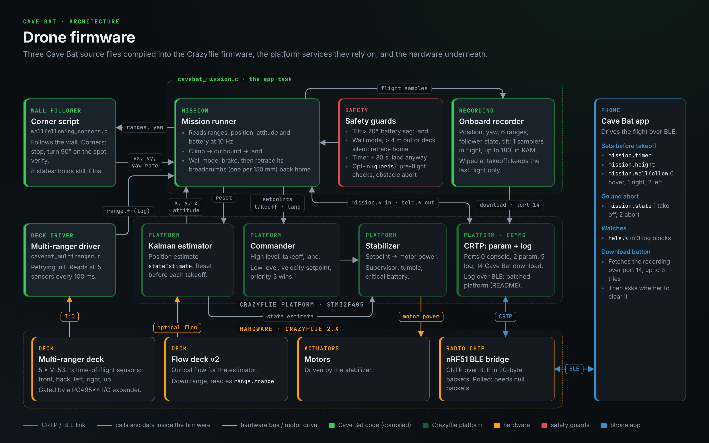
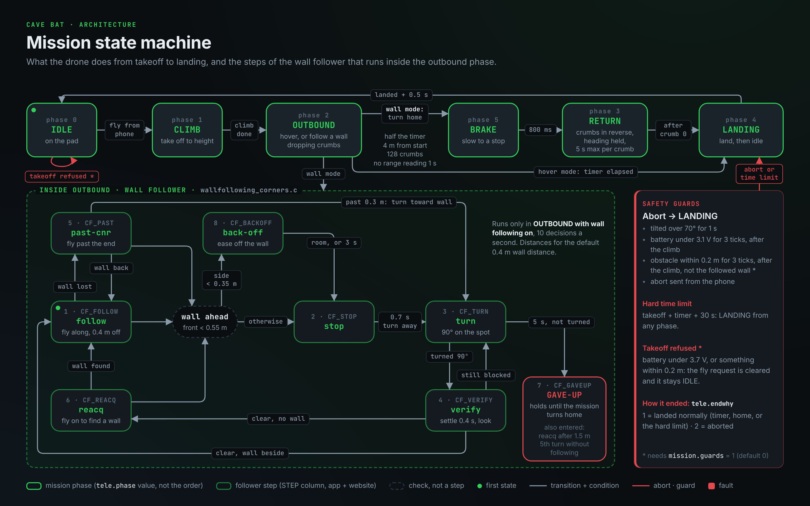

# Cave Bat firmware

Firmware for a Bitcraze Crazyflie 2.x nano-quadcopter that explores indoors
without GPS: it takes off, follows a wall around corners, flies back along its
own trail, and lands. Written in C as an out-of-tree app for the
`crazyflie-firmware` platform, running on the drone's STM32F405.

It is one of three parts of the Cave Bat project:

| Repository | Role |
|---|---|
| **cave_bat_firmWare** (this) | Autonomous flight: mission, wall following, return to home, safety, onboard recording |
| [cave-controller](https://github.com/yaligbd/cave-controller) | React Native phone app: starts and monitors the mission over Bluetooth LE, downloads the recording |
| [gcs](https://github.com/yaligbd/gcs) | Website and API: stores every flight and replays it in 3D |



## How a mission works

The phone sets a few parameters and writes `mission.state = 1`. From then on the
drone flies on its own; the phone watches the telemetry and can abort.

1. **Climb** to `mission.height`. The position estimator is reset and allowed
   to settle on the pad first.
2. **Outbound.** In hover mode the drone holds position until `mission.timer`
   runs out, then lands. In wall mode the wall follower
   (`wallfollowing_corners.c`) keeps `mission.walldist` from a wall on the right
   or left and turns corners as a script: stop, turn 90° on the spot, verify,
   carry on.
3. **Brake** (wall mode). The forward speed ramps to zero over 0.8 s; an instant
   stop pitches the aircraft up and costs height.
4. **Return** along the breadcrumb trail (below), then
5. **land**. The recording stays in RAM for the phone to download.



### Return to home

There is no GPS and no map. The Kalman estimator fuses the Flow deck (optical
flow and a downward laser) with the IMU into a position relative to the takeoff
point. On the way out the drone saves a **breadcrumb** (x, y and the height
actually flown) every 150 mm, up to 128 of them. On the way back it flies to
the breadcrumbs in reverse order at 0.2 m/s, holding its heading so the
estimate stays consistent. A breadcrumb within 150 mm counts as reached; one
that cannot be reached within 5 s is skipped.

The Multi-ranger does not steer the return, it only vetoes motion: the velocity
component into an obstacle is removed, so the drone slides along a wall instead
of pushing into it. The return is only as accurate as the position estimate:
drift on the way out moves the whole trail.

### When it turns for home (wall mode)

| `tele.outwhy` | Reason |
|---|---|
| 1 | half of `mission.timer` has passed since the climb |
| 2 | more than 4 m from the takeoff point (geofence) |
| 4 | the breadcrumb trail is full |
| 7 | every range sensor has read nothing for 1 s |

### Safety

| Condition | Action |
|---|---|
| tilt over 70° for 1 s | abort and land |
| battery under `minvbat` − 0.6 V for 3 ticks, after the climb | abort and land |
| `mission.timer` + 30 s since takeoff | land, whatever the phase |
| `mission.state = 2` from the phone | abort and land |
| with `guards = 1`: battery under `minvbat`, or an obstacle within `minobst`, on the pad | refuse to take off |
| with `guards = 1`: an obstacle within `minobst` in flight (ignoring the followed wall) | abort and land |

`tele.endwhy` reports how the flight ended: 1 landed normally, 2 aborted.

## Onboard recording

Once a second in flight the drone stores a 16-byte sample in RAM, up to 180
samples (3 minutes): position (mm), heading, the six ranges (2 cm units,
0 = no reading), the wall follower's step and mode, and the worst tilt in that
second. The recording is cleared at takeoff and lost at power-off; the phone
downloads it after landing over CRTP port 14.

## Parameters

The phone reads and writes these over the CRTP parameter port.

### `mission`: what to do

| Name | Type | Default | Meaning |
|---|---|---|---|
| `state` | uint8 | 0 | 0 idle, 1 fly, 2 abort |
| `timer` | uint32 | 10 | mission length, s |
| `height` | uint32 | 500 | flight height, mm |
| `wallfollow` | uint8 | 0 | 0 hover, 1 follow a wall on the right, 2 on the left |
| `walldist` | uint32 | 400 | distance to keep from the wall, mm |
| `minvbat` | uint32 | 3700 | minimum battery on the pad, mV |
| `minobst` | uint32 | 200 | obstacle clearance for the guards, mm |
| `guards` | uint8 | 0 | 1 enables the optional pre-flight and obstacle guards |
| `sampledist` | uint32 | 10 | not used by the current build |

### `tele`: what the drone reports

Available as parameters and as a `tele` log group. The log group also carries
`phase`, `outwhy` and `yaw`.

| Name | Type | Meaning |
|---|---|---|
| `alive` | uint16 | counts up while the app task runs |
| `canfly` | uint8 | battery is at or above `minvbat` |
| `clear` | uint8 | nothing within `minobst` |
| `phase` | uint8 | 0 idle, 1 climb, 2 outbound, 3 return, 4 landing, 5 brake (log only) |
| `maxz` | uint16 | highest altitude reached, mm |
| `samples` | uint16 | samples recorded |
| `endwhy` | uint8 | 1 landed normally, 2 aborted |
| `vbat` | uint16 | battery, mV |
| `front` `back` `left` `right` `up` `down` | uint16 | ranges, mm; 0 = no reading |
| `x` `y` `z` | int16 | estimated position, mm |

## Source files

Built (selected in `src/Kbuild`):

| File | Role |
|---|---|
| `src/cavebat_mission.c` | The app: mission phases, breadcrumbs, return, safety guards, recorder, download |
| `src/wallfollowing_corners.c/.h` | The wall follower: follow, stop, turn, verify, pass a corner, re-acquire, back off |
| `src/cavebat_multiranger.c` | Multi-ranger deck driver with a retrying start-up, replacing the stock driver (`CONFIG_DECK_MULTIRANGER=n` in `app-config`) |

Kept for reference, not built: earlier app versions (`cavebat.c`,
`cavebat_record.c`, `cavebat_wall.c`, `cavebat_v2.c`, `cavebat_v3.c`), an I2C
scan diagnostic (`cavebat_i2cscan.c`), and two other wall-following strategies,
`wallfollowing_multiranger_onboard.c` (Bitcraze) and `wallfollowing_tudelft.c`
(TU Delft), credited in their headers.

## Building

Builds against a checkout of Bitcraze's
[`crazyflie-firmware`](https://github.com/bitcraze/crazyflie-firmware) with the
ARM GCC toolchain. Point `CRAZYFLIE_BASE` in the `Makefile` at that checkout,
then:

```bash
make
```

- `app-config` must reach the build with `CONFIG_APP_ENABLE=y`. If `appMain`
  never starts, check which config the build picked up first.
- The config is cached in `build/.config`. After changing `app-config` or
  `src/Kbuild`, run `rm -rf build && make`.

## Flashing

Over a Crazyradio PA:

```bash
cfloader flash build/cf2.bin stm32-fw
```

- Bootloader mode: with the drone off, hold the power button about 3 s until
  the blue LEDs blink fast.
- Plug the Crazyradio in directly; a USB hub causes packet loss. On WSL, repeat
  `usbipd attach` after every restart.
- Unplug the Crazyradio before flying over BLE: the nRF51 turns BLE off while it
  sees radio traffic.

`known-good/` holds a verified binary for each milestone, so the drone can
always be put back on a build that flew. See
[known-good/README.md](known-good/README.md).

## Bluetooth LE notes

The BLE bridge runs on the nRF51, not the STM32:

- Packets are limited to 20 bytes, which truncates long parameter names.
- It is poll-driven: the phone keeps a stream of null packets going so data
  keeps flowing back.
- Stock firmware only starts CRTP log blocks for the radio link. The platform
  build used here is patched so log blocks also stream over BLE, which gives
  the phone live telemetry.

## Hardware

- Bitcraze Crazyflie 2.x (STM32F405 + nRF51822)
- Flow deck v2
- Multi-ranger deck
- Crazyradio PA, for flashing only
